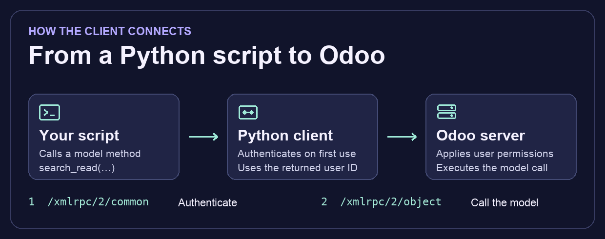
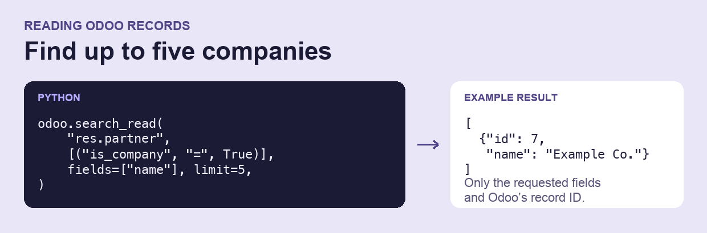

# Odoo XML-RPC Client

Read and update Odoo records from Python scripts. The client handles authentication, wraps common model methods, and has no runtime dependencies. Requires Python 3.9 or later.



## Quick start

Clone the repository, then install it from its root directory.

```sh
python -m pip install .
```

Set these variables in your script's environment.

| Variable | Value |
| --- | --- |
| `ODOO_URL` | Instance base URL, such as `https://odoo.example.com` |
| `ODOO_DB` | Database name |
| `ODOO_USERNAME` | Odoo login |
| `ODOO_API_KEY` | API key. Set `ODOO_PASSWORD` instead if your instance uses password authentication. |

Run the [read-only example](examples/list_companies.py) from the repository root.

```sh
python examples/list_companies.py
```

```python
from odoo_xmlrpc_client import Odoo

with Odoo.from_env() as odoo:
    companies = odoo.search_read(
        "res.partner",
        [("is_company", "=", True)],
        fields=["name"],
        limit=5,
    )
    for company in companies:
        print(company["name"])
```



## Client methods

| Task | Methods |
| --- | --- |
| Check server availability and sign in | `version()`, `authenticate()` |
| Find or read records | `search()`, `search_read()`, `search_count()`, `read()`, `name_search()` |
| Change records | `create()`, `write()`, `unlink()` |
| Inspect fields or call another model method | `fields_get()`, `execute_kw()` |

`version()` works before authentication. The first model call authenticates automatically. Use HTTPS for remote instances. HTTPS verifies certificates by default. The request timeout defaults to 30 seconds and can be set with `Odoo.from_env(timeout=10)`. Use a separate client instance per thread.

Model operations use the configured Odoo user's permissions. The client sends each request once. If the connection drops during a write, check the server state before retrying it.

## Compatibility

The server must expose `/xmlrpc/2/common` and `/xmlrpc/2/object`. For hosted Odoo, check that your plan includes external API access. Odoo has deprecated XML-RPC and recommends JSON-2 for new integrations on servers that support it. [Odoo external RPC documentation](https://www.odoo.com/documentation/19.0/developer/reference/external_rpc_api.html)

## Repository

- [Package source](src/odoo_xmlrpc_client/) contains the client.
- [Examples](examples/) contain runnable usage examples.
- [Tests](tests/) use a local XML-RPC server and fictitious credentials.
- [Contributing](CONTRIBUTING.md) covers local setup and tests.
